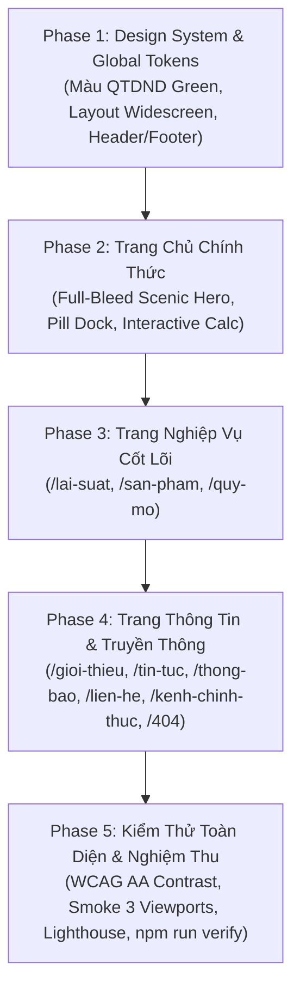

# LỘ TRÌNH CHUYỂN ĐỔI (MIGRATION ROADMAP)

## Đồng bộ toàn diện website theo Phong cách Ngân hàng số Hiện đại & Tông màu QTDND

> **Tài liệu tham chiếu:** Dựa trên chuẩn mực `AGENTS.md`, quy trình `.agent/workflows/next-task.md` và bản thử nghiệm thành công tại `src/pages/poc-vcb.astro`.
> **Mục tiêu:** Chuyển đổi toàn diện toàn bộ 14 trang web từ phong cách cũ sang phong cách mới: trang nền phong cảnh nông thôn tràn viền (Full-Bleed Scenic Landscape), tông màu xanh lá đặc trưng của Logo QTDND (`#00a85a` / `#008a49`), bố cục màn ảnh rộng hiện đại loại bỏ khoảng trống thừa hai bên, kèm công cụ tài chính tương tác.

---

## TỔNG QUAN CÁC PHASE



---

## CHI TIẾT TỪNG PHASE & PROMPT THỰC THI

### PHASE 1: Chuẩn hoá Design System, Global Tokens & Khung Layout Chung

#### 1. Mục tiêu

- Cập nhật biến màu trong `src/styles/global.css`:
  - `--color-brand-primary`: chuyển từ Navy (`#0f3666`) sang Xanh QTDND (`#00a85a`).
  - `--color-brand-primary-hover`: `#008a49`.
  - `--color-brand-dark`: `#015a30`.
  - `--color-accent-gold`: `#ffd100` (bông lúa vàng).
  - `--color-surface-brand-subtle`: `#f0faf4` (nền xanh lá dịu mắt).
- Cải tiến component `Container.astro`: Mở rộng container lên `max-w-[1536px]` với padding responsive chuẩn (`px-4 sm:px-8 lg:px-12`), giải quyết triệt để vấn đề dư thừa khoảng trắng hai bên trên màn hình desktop lớn.
- Cập nhật `Header.astro` & `Footer.astro`:
  - Tích hợp Logo QTDND cổ điển sắc nét ([logo-qtdnd-classic.png](/images/logo-qtdnd-classic.png)) đồng bộ với tem Bảo hiểm DIV trong suốt.
  - Header kính mờ mềm mại (frosted glass) và thanh phân khúc khách hàng (Segment Bar).
  - Footer phối màu xanh QTDND đồng điệu, thông tin giấy phép, giờ làm việc và liên kết nhanh.

#### 2. Tiêu chuẩn hoàn thành (DoD)

- [ ] `npm run lint` & `npm run check` không lỗi.
- [ ] Bảng màu mới đạt chuẩn tương phản WCAG AA (`npm run check:contrast`).
- [ ] Header & Footer hiển thị đồng bộ trên mọi trang, không bị cuộn ngang.

#### 3. Prompt thực hiện Phase 1 (Dành cho Agent)

```text
Thực hiện Phase 1 trong docs/ROADMAP-MIGRATION-POC.md:
1. Mở src/styles/global.css, cập nhật các biến theme Tailwind v4:
   - Thay thế màu brand primary sang mã màu xanh logo QTDND: --color-brand-primary: #00a85a; hover: #008a49; dark: #015a30.
   - Thêm sắc thái vàng lúa: --color-brand-gold: #ffd100;
   - Cập nhật nền tinh tế: --color-surface-brand-subtle: #f0faf4.
2. Mở src/components/ui/Container.astro, nâng độ rộng tối đa từ max-w-6xl lên chuẩn màn ảnh rộng max-w-[1536px] (padding: px-4 sm:px-8 lg:px-12) để loại bỏ khoảng trắng dư thừa hai bên.
3. Cập nhật src/components/Header.astro và src/components/Footer.astro theo phong cách POC v2:
   - Sử dụng logo QTDND truyền thống public/images/logo-qtdnd-classic.png.
   - Header dùng hiệu ứng nền kính mờ bg-white/85 backdrop-blur-md border-b border-emerald-900/10.
   - Bổ sung thanh phân khúc khách hàng mini kiểu Vietcombank ở đỉnh trang.
   - Footer đồng bộ màu xanh QTDND và tem Bảo hiểm DIV tách nền trong suốt.
4. Chạy kiểm tra chất lượng: npm run lint, npm run check, npm run build, npm run check:contrast, npm run check:dist và dán output thật vào báo cáo.
```

---

### PHASE 2: Di chuyển & Hoàn thiện Trang Chủ Chính Thức (`/`)

#### 1. Mục tiêu

- Thay thế toàn bộ nội dung của `src/pages/index.astro` bằng kiến trúc giao diện phong cảnh tràn viền từ `src/pages/poc-vcb.astro`:
  - **Full-Bleed Scenic Hero**: Đồi xanh, ruộng bậc thang lúa vàng, dòng sông uốn lượn, mặt trời dịu êm trải dài 100% chiều ngang màn hình.
  - **Lời chào thời gian thực**: "Chào buổi sáng / Chào buổi chiều / Chào buổi tối" tự động cập nhật theo giờ Việt Nam.
  - **Thanh tìm kiếm nhanh hình viên thuốc**: Tìm nhanh biểu lãi suất, hồ sơ vay vốn, dịch vụ Co-opBank.
  - **Floating Pill Dock**: Thanh 6 tiện ích nổi hình viên thuốc bo tròn mềm mại (Gói Nông Nghiệp, Biểu Lãi Suất, Tính Tiền Gửi, Vay Thành Viên, App Co-opBank, Mạng Lưới Quỹ).
  - **Công cụ tính lãi tiết kiệm tương tác trực tiếp**: Slider + nút chọn nhanh số tiền (20tr - 200tr) và kỳ hạn (1 - 36 tháng).
  - **Khối Quy mô & Trụ cột niềm tin**: 4 số liệu vốn điều lệ, tổng tài sản, dư nợ, thành viên cùng tem DIV.
  - **Lưới Tin tức & An sinh xã hội**: Hiển thị các bài viết và hình ảnh hoạt động thực tế.

#### 2. Tiêu chuẩn hoàn thành (DoD)

- [ ] Trang chủ mới vận hành chính thức tại `/`.
- [ ] Toàn bộ bài smoke tests trên trang chủ pass trên 3 viewports: 360px, 768px, 1280px (không lỗi cuộn ngang, không console error).
- [ ] Tuân thủ tuyệt đối CSP: Không có inline script hay inline style.

#### 3. Prompt thực hiện Phase 2 (Dành cho Agent)

```text
Thực hiện Phase 2 trong docs/ROADMAP-MIGRATION-POC.md:
1. Chuyển đổi toàn diện src/pages/index.astro sang giao diện phong cảnh tràn viền phong cách Vietcombank từ src/pages/poc-vcb.astro:
   - Giữ nguyên các hàm nạp dữ liệu chuẩn: getSite(), getRates(), getContact(), getSchedule(), getPublishedNews().
   - Đặt nền phong cảnh vector đồi lúa vàng & dòng sông tràn viền 100% chiều ngang (w-full).
   - Tích hợp lời chào theo thời gian thực (src/scripts/poc-calc.ts) và thanh tìm kiếm nhanh hình viên thuốc.
   - Triển khai thanh tiện ích Floating Pill Dock bo tròn mềm mại với 6 lối tắt chức năng.
   - Nhúng công cụ tính lãi suất tiền gửi tương tác trực tuyến với slider và chọn kỳ hạn.
   - Bố trí khối Quy mô hoạt động 4 thẻ chỉ số và tem Bảo hiểm DIV tách nền sắc nét.
   - Hiển thị lưới tin tức và hoạt động an sinh xã hội địa phương.
2. Xóa bỏ banner thử nghiệm POC trên trang chủ sau khi đã chuyển đổi thành công.
3. Chạy kiểm tra: npm run lint, npm run check, npm run build, npm run test:unit, npm run check:dist và kiểm tra Playwright trên trang chủ. Dán output xác nhận.
```

---

### PHASE 3: Đồng bộ các Trang Dịch vụ & Nghiệp vụ Cốt lõi (`/lai-suat`, `/san-pham`, `/quy-mo`)

#### 1. Mục tiêu

- **Trang Lãi suất (`/lai-suat`)**:
  - Banner đầu trang nhỏ gọn với nền phong cảnh xanh QTDND.
  - Bảng biểu lãi suất tiền gửi & cho vay kế thừa `RatesTables.astro` với viền bo góc mềm `rounded-2xl`, hiệu ứng hover hàng nổi bật và lưu ý pháp lý _"Lãi suất mang tính tham khảo..."_ đặt ngay đầu bảng.
  - Tích hợp thêm widget công cụ tính lãi suất nhanh bên dưới bảng biểu để tăng tính tiện ích cho bà con.
- **Trang Sản phẩm (`/san-pham`)**:
  - Chuyển sang bố cục dạng thẻ lớn hiện đại có phân chia danh mục: Vay phát triển nông nghiệp nông thôn, Vay kinh doanh dịch vụ, Tiền gửi tiết kiệm, và Dịch vụ số Co-opBank (Thẻ chip Napas, Mobile Banking).
  - Tông màu xanh lá `#00a85a` làm chủ đạo, icon trực quan, danh sách lợi ích dạng bullet chuẩn mực.
- **Trang Quy mô (`/quy-mo`)**:
  - Nâng cấp lưới thẻ quy mô với viền kính xanh QTDND, làm nổi bật Vốn điều lệ 52 tỷ và Tổng tài sản 1.270 tỷ đồng.
  - Bổ sung khối _"Cam kết bảo vệ quyền lợi thành viên & Bảo hiểm tiền gửi Việt Nam"_.

#### 2. Tiêu chuẩn hoàn thành (DoD)

- [ ] Cả 3 trang `/lai-suat`, `/san-pham`, `/quy-mo` đều có giao diện đồng bộ với trang chủ mới.
- [ ] Các bài test trong `tests/pages.spec.ts` pass 100% (kiểm tra bảng, disclaimer, stat cards).

#### 3. Prompt thực hiện Phase 3 (Dành cho Agent)

```text
Thực hiện Phase 3 trong docs/ROADMAP-MIGRATION-POC.md:
1. Đồng bộ trang Lãi suất (src/pages/lai-suat.astro):
   - Thay banner đầu trang bằng phong cách xanh QTDND nhẹ nhàng, hiện đại.
   - Giữ nguyên cấu trúc dữ liệu rates.yaml và disclaimer pháp lý bắt buộc.
   - Tích hợp thêm khối tính lãi tiền gửi tương tác phía dưới bảng lãi suất.
2. Đồng bộ trang Sản phẩm (src/pages/san-pham.astro):
   - Thiết kế lại các nhóm sản phẩm (Vay thành viên, Tiết kiệm, Dịch vụ đại lý Co-opBank) thành dạng thẻ bo góc lớn rounded-3xl với tông màu xanh QTDND #00a85a.
   - Thêm nhãn nổi bật cho các dịch vụ mới: Thẻ chip Co-opBank Napas, Mobile Banking.
3. Đồng bộ trang Quy mô (src/pages/quy-mo.astro):
   - Nâng cấp 4 thẻ số liệu theo phong cách thẻ nổi mới, gắn tem Bảo hiểm tiền gửi DIV sắc nét.
4. Chạy kiểm tra chất lượng: npm run lint, npm run check, npm run build, npx playwright test tests/pages.spec.ts, npm run check:dist.
```

---

### PHASE 4: Đồng bộ các Trang Thông tin, Tin tức & Truyền thông

#### 1. Mục tiêu

- **Trang Giới thiệu, Lịch sử, Ban lãnh đạo (`/gioi-thieu`, `/lich-su`, `/ban-lanh-dao`)**:
  - Banner tiêu đề trang (PageHeader) có dải nền đồi lúa nhẹ và breadcrumb phong cách mới.
  - Tôn vinh dấu mốc lịch sử HTX Tín dụng 1958 &rarr; chuyển đổi QTDND 1996.
  - Khung ảnh trụ sở chính và cơ cấu tổ chức theo thẻ bo góc mềm mại.
- **Trang Tin tức & Thông báo (`/tin-tuc`, `/thong-bao`, `/tin-tuc/[slug]`)**:
  - Danh mục bài viết với các thẻ badge màu xanh QTDND tươi sáng.
  - Trang chi tiết bài viết có typography chuẩn báo chí, dễ đọc cho người lớn tuổi, cỡ chữ gốc 16px-18px, độ tương phản cao.
- **Trang Liên hệ & Kênh chính thức (`/lien-he`, `/kenh-chinh-thuc`, `/404`)**:
  - Hộp thông tin liên hệ nổi bật với số hotline, email, giờ phục vụ 2 ca rõ ràng.
  - Bản đồ Google Maps an toàn, thông tin nhận diện kênh chính thức chống giả mạo.
  - Trang 404 thân thiện, đồng bộ tông màu xanh QTDND.

#### 2. Tiêu chuẩn hoàn thành (DoD)

- [ ] Toàn bộ các trang phụ đều sở hữu giao diện nhất quán.
- [ ] Không có link hỏng, không có ảnh thiếu alt, không vi phạm CSP headers.

#### 3. Prompt thực hiện Phase 4 (Dành cho Agent)

```text
Thực hiện Phase 4 trong docs/ROADMAP-MIGRATION-POC.md:
1. Đồng bộ các trang giới thiệu:
   - src/pages/gioi-thieu.astro, src/pages/lich-su.astro, src/pages/ban-lanh-dao.astro.
   - Áp dụng PageHeader mới với dải nền xanh đồi lúa nhẹ, breadcrumb rõ ràng và typography sắc nét.
2. Đồng bộ các trang tin tức và thông báo:
   - src/pages/tin-tuc/index.astro, src/pages/tin-tuc/[slug].astro, src/pages/thong-bao.astro.
   - Cập nhật màu sắc nhãn phân loại (badge), ngày tháng và thanh phân trang theo tông màu #00a85a.
3. Đồng bộ trang Liên hệ & Kênh chính thức:
   - src/pages/lien-he.astro, src/pages/kenh-chinh-thuc.astro, src/pages/404.astro.
   - Làm nổi bật hộp địa chỉ trụ sở, số điện thoại hotline và sơ đồ chỉ dẫn.
4. Chạy kiểm tra: npm run lint, npm run check, npm run build, npm run test:unit, npm run check:dist.
```

---

### PHASE 5: Kiểm Thử Toàn Diện, Tối Ưu Trợ Năng (WCAG AA) & Nghiệm Thu

#### 1. Mục tiêu

- Dọn dẹp các file thử nghiệm tạm (`src/pages/poc-vcb.astro` có thể gỡ bỏ hoặc chuyển vào archive).
- Kiểm tra toàn diện trên 4 kích thước màn hình: 360px (mobile), 768px (tablet), 1280px (laptop), 1920px (màn hình rộng).
- Chạy toàn bộ bộ test kiểm thử: Playwright smoke tests, Axe accessibility (WCAG AA), kiểm tra độ tương phản, Lighthouse CI.
- Chạy lệnh xuất xưởng `npm run verify` đạt 100% PASS và cập nhật `docs/PROGRESS.md`.

#### 2. Tiêu chuẩn hoàn thành (DoD)

- [ ] `npm run verify` đạt PASS toàn bộ các bước (lint, check, build, test, check:dist, lhci:quick, check:contrast, eol).
- [ ] Không phát sinh lỗi tràn ngang trên bất kỳ trang nào.
- [ ] Báo cáo chặng và cập nhật tiến độ đầy đủ theo quy trình `.agent/workflows/next-task.md`.

#### 3. Prompt thực hiện Phase 5 (Dành cho Agent)

```text
Thực hiện Phase 5 trong docs/ROADMAP-MIGRATION-POC.md:
1. Rà soát và dọn dẹp các route thử nghiệm tạm thời (loại bỏ /poc-vcb khỏi nav.ts và thư mục pages sau khi trang chủ đã hoàn thiện).
2. Chạy kiểm tra độ tương phản và trợ năng: npm run check:contrast. Đảm bảo mọi cặp màu chữ/nền xanh QTDND #00a85a và vàng lúa #ffd100 đều đạt chuẩn WCAG AA.
3. Chạy bộ kiểm thử tự động toàn diện:
   - npm run test (Playwright smoke tests trên desktop, tablet, mobile)
   - npm run test:unit (Unit tests nghiệp vụ)
   - npm run test:empty (Kiểm thử trạng thái rỗng)
   - npm run check:dist (Kiểm tra bảo mật và tài nguyên tĩnh xuất xưởng)
   - npm run lhci:quick (Kiểm tra hiệu năng Lighthouse)
4. Chạy lệnh chốt kiểm tra tổng thể: npm run verify.
5. Cập nhật nhật ký tiến độ trong docs/PROGRESS.md với commit hash và trạng thái hoàn thành.
```

---

## BẢNG MA TRẬN THEO DÕI TIẾN ĐỘ CHUYỂN ĐỔI

| Phase | Nội dung chính                 | Trọng tâm thay đổi                                                      |          Trạng thái           |
| :---: | :----------------------------- | :---------------------------------------------------------------------- | :---------------------------: |
| **1** | Design System & Global Tokens  | Màu xanh QTDND `#00803e`, Container widescreen, Header/Footer           | `[x] Đã hoàn thành (59d8e35)` |
| **2** | Trang Chủ Chính Thức (`/`)     | Phong cảnh tràn viền, Lời chào thời gian thực, Pill Dock, Tính lãi suất | `[x] Đã hoàn thành (697b0eb)` |
| **3** | Trang Nghiệp Vụ Cốt Lõi        | Bảng lãi suất thẻ kính, Sản phẩm theo nhu cầu, Quy mô & Bảo hiểm DIV    | `[x] Đã hoàn thành (05d3ab5)` |
| **4** | Trang Thông Tin & Truyền Thông | Giới thiệu HTX 1958, Tin tức & Thông báo, Liên hệ & Bản đồ              | `[x] Đã hoàn thành (4ea0e43)` |
| **5** | Kiểm Thử & Chốt Nghiệm Thu     | WCAG AA, Smoke 3 Viewports, Lighthouse, Tối ưu cuộn mượt 60fps          |      `[x] Đã hoàn thành`      |
